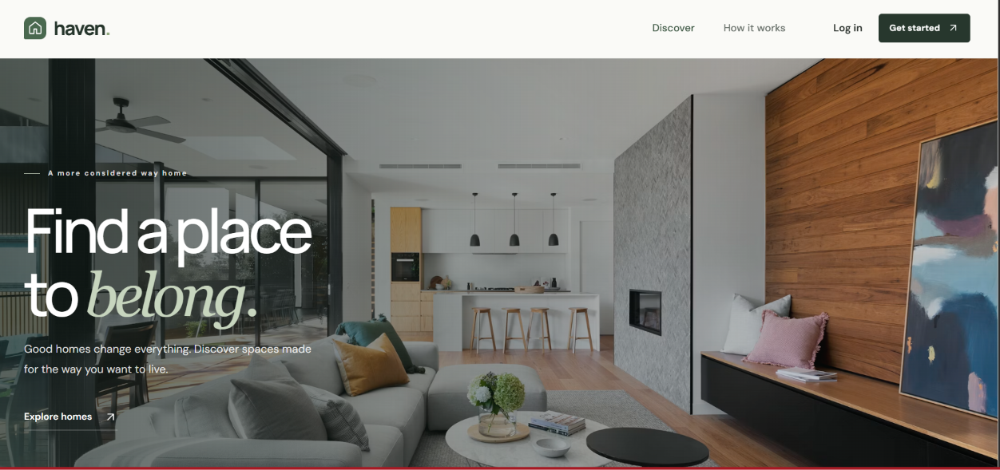
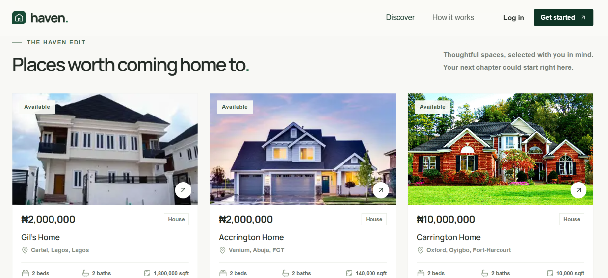
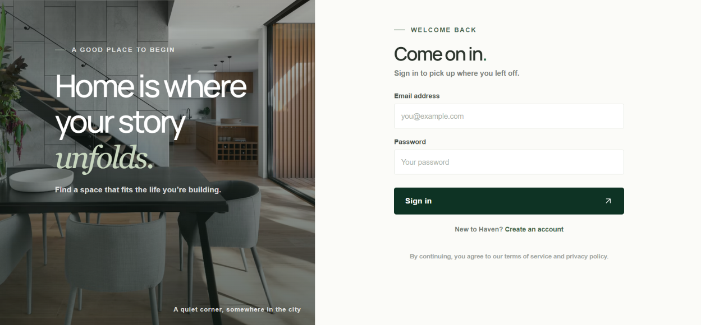
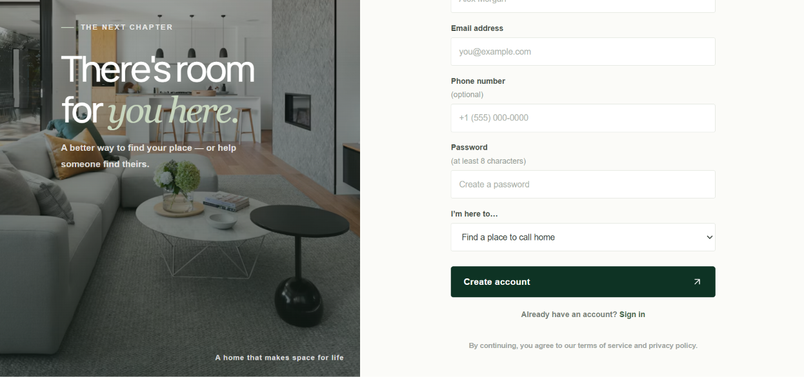

# Property Listing Front End App

A front end application for users & owners to list, sell and buy homing properties that suites their needs and preferences. Here at Haven, we are driven at helping everyone in need to find their potential new home and also aid home owners sell their homes at a very good and affordable price.

The front end app is designed to be flexible, very easy to navigate and user friendly for both old and new users of the app.

# Front End URL (Render)
- `https://haven-homes-ebma.onrender.com`

# Backend API
- API base URL: `https://property-listing-app-backend-2m81.onrender.com/api/v1`
- API documentation: `https://property-listing-app-backend-2m81.onrender.com/api-docs/#/`

For local development, `VITE_API_URL` defaults to `http://localhost:5000/api/v1`; start the backend before the frontend. Set it to `https://property-listing-app-backend-2m81.onrender.com/api/v1` when building for the deployed backend. Registration is immediate; sign in with the email and password used to create the account.

# Stacks Used For Creating App
* **FrameWork & Build Tools:**
- React.js + Vite (User Interface and Interactions)
- Javascript (ES6+/JSX)
- HTML5 (index.html)

# UI & Styling Assets:
- Google Fonts (DM Sans, Manrope)

# Package & Environment Management:
- Node.js/npm (package.json & package-lock.json)
- Environment Variables (.env); dot.env only if directly used

# Developer & Version Control Tools:
- Git & GitHub (Version Control with Git; .gitignore for excluded files)
- VS Code (Code Editor)

## Application Shortcuts

### Homepage

### Property Listings

### Login Page

### Registration Page
